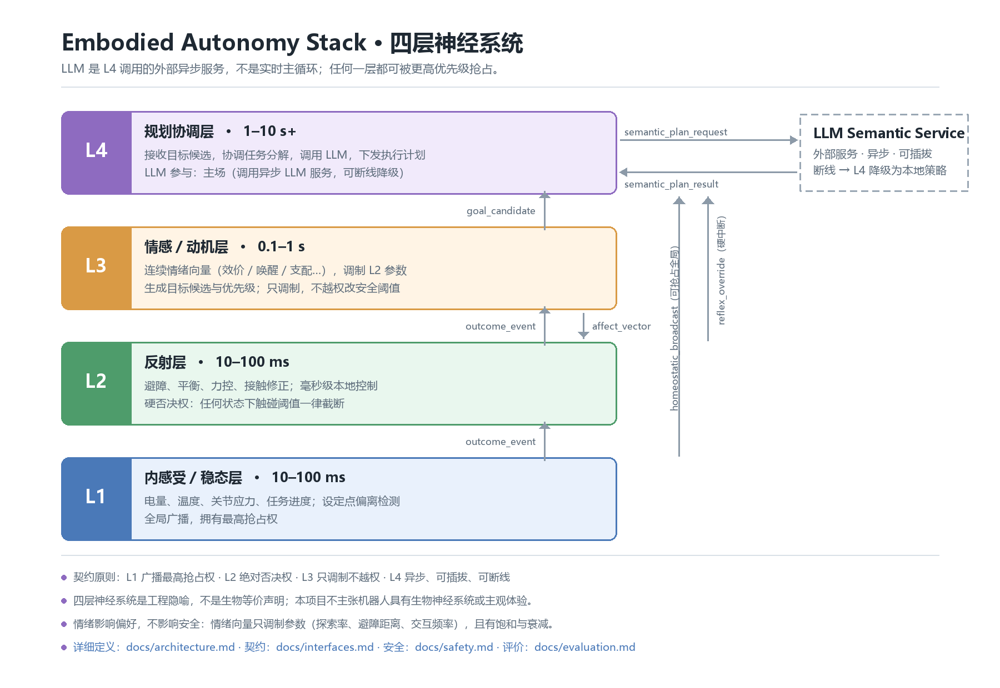

# Embodied Autonomy Stack · 具身自主栈

**给 LLM 划边界，给具身智能补上稳态、反射、情感调制、需求生成与执行修正。**


[](LICENSE)

> **当前状态**：v0.1 设计草案 / RFC，**尚无可运行代码**。
> 当前目标是定义接口契约，并跑通仿真最小闭环（阶段 1：解决自身需求）。本项目是架构实验场，不是已发布框架。



## 主张

LLM 是具身智能的重要组件，但不应成为实时控制与稳态调节的中心。
本项目给 LLM 划出该在的位置（语义规划与沟通），并补上它能力边界之外的自主能力：
稳态调节、反射、情感调制、需求生成、执行修正。

> **核心命题**：只有机器人先学会解决自己的需求，后续才有可能自主去解决那些程序看不出来的需求。

## 四层

| 层 | 时间尺度 | 一句话职责 | LLM |
|---|---|---|---|
| **L1** 内感受/稳态 | 10–100 ms | 检测设定点偏离，全局广播，最高抢占权 | 不参与 |
| **L2** 反射 | 10–100 ms | 毫秒级避障/平衡/力控，硬否决权 | 不参与 |
| **L3** 情感/动机 | 0.1–1 s | 连续情绪向量调制参数，生成目标候选 | 不参与 |
| **L4** 规划协调 | 1–10 s+ | 目标排序、任务分解、调用 LLM、下发执行 | 主场（调外部服务） |

L4 不是 LLM；LLM 是 L4 调用的**外部异步服务**，可插拔、可断线。

## 仓库地图

| 目录 | 是什么 | 先看哪个 |
|---|---|---|
| [`docs/`](docs/) | 正文：为什么、架构、契约、评价、安全、路线图 | [docs/README.md](docs/README.md) |
| [`contracts/`](contracts/) | 层间信号的 JSON Schema + 样例（机器可校验） | [contracts/README.md](contracts/README.md) |
| [`evals/`](evals/) | 四条基线配置、指标定义、复现日志格式 | [evals/README.md](evals/README.md) |
| [`site/`](site/) | 文档站（VitePress，深色 · 等宽 · 架构图） | [site/README.md](site/README.md) |
| [`.github/`](.github/) | Issue / PR 模板 | [架构 RFC 模板](.github/ISSUE_TEMPLATE/architecture-rfc.yml) |

**为什么先有 schema 再有代码**：表是给人读的，schema 是给实现和 CI 读的。
契约先落地，谁实现 L3 都得对齐——这就是架构约束力。

## 想读哪一块

- 这个项目到底主张什么 → [docs/vision.md](docs/vision.md)
- 四层怎么分、各自不做什么 → [docs/architecture.md](docs/architecture.md)
- 层与层传什么信号 → [docs/interfaces.md](docs/interfaces.md) · [contracts/](contracts/)
- 怎么证明"有效"、和谁比 → [docs/evaluation.md](docs/evaluation.md) · [evals/](evals/)
- 情绪会不会影响安全 → [docs/safety.md](docs/safety.md)
- 下一步做什么 → [docs/roadmap.md](docs/roadmap.md)

## 文档站

`site/` 是 VitePress 站点（深色终端风、等宽字体、可点击的分层架构图），由 GitHub Actions 构建并发布到 GitHub Pages。
站点地址：<https://pjtbot.xyz/> · 本地起服：`cd site && pnpm install && pnpm docs:dev`。

站点**不复制** `docs/` 的正文，避免双份维护分裂；站内页面由 `docs/` 同步生成（第二步接入），
在那之前导航指向 GitHub 原文。

## 快速开始

```bash
git clone https://github.com/Peng-EA/embodied-autonomy-stack.git
cd embodied-autonomy-stack

# 没有可运行代码。当前能做的三件事：
$EDITOR docs/architecture.md          # 看分层
$EDITOR contracts/signals.schema.json # 看契约
# 按 evals/log-format.md 记录复现日志，提到 Discussions / Issue
```

## 参与

流程是**先 Issue/RFC → 再 PR → 附证据**。契约类改动必须先有 ADR。
细节见 [CONTRIBUTING.md](CONTRIBUTING.md)，行为准则见 [CODE_OF_CONDUCT.md](CODE_OF_CONDUCT.md)，
安全问题（含物理安全）见 [SECURITY.md](SECURITY.md)。

新手任务用 `good-first-architecture` 标签。**负结果同样欢迎**——能用实验推翻上述主张，也是贡献。

## 路线图

| 版本 | 这一版要证明什么 |
|---|---|
| v0.1 | 这套分层能在仿真里跑通"解决自身需求"的闭环 |
| v0.2 | 需求能**自主**产生，而不是被写死 |
| v0.3 | 出错能自己修，抢占判定是对的 |
| v0.4 | 能力随时间增长（SHOULD） |

详见 [docs/roadmap.md](docs/roadmap.md)。

## English Summary

Embodied Autonomy Stack is an open architecture RFC for embodied autonomy.
LLM is a powerful semantic planner, but it should not be the real-time control center or the source of homeostasis.
We propose a four-layer, multi-timescale architecture: L1 interoception/homeostasis → L2 reflex → L3 affect/motivation → L4 asynchronous planning (which calls LLM as an external service).
Goal: first let the robot solve its own needs (Stage 1), then discover needs outside program/LLM plans (Stage 2).
Status: v0.1 design RFC, no runnable code yet. Contributions welcome via Issues and docs.

## License

[Apache-2.0](LICENSE)。

---

欢迎质疑与实验反驳，欢迎用实验推翻我们的架构假设。

**只有它会解决自己的需求了，后续才有可能自主去解决那些程序看不出来的需求。**
