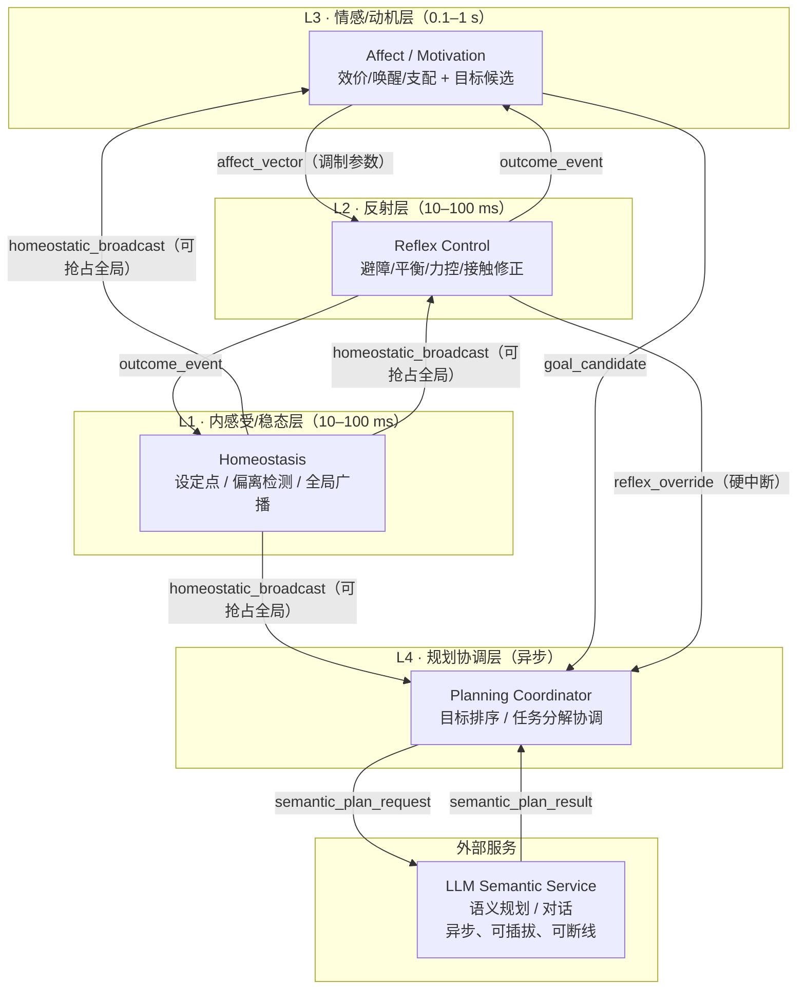

# Embodied Autonomy Stack · 具身自主栈

**给 LLM 划边界，给具身智能补上稳态、反射、情感调制、需求生成与执行修正。**


> **当前状态**：v0.1 设计草案 / RFC，尚无可用代码。当前目标是定义接口契约，并跑通仿真最小闭环（阶段 1：解决自身需求）。本项目是架构实验场，不是已发布框架。

LLM 是具身智能的重要组件，但不应成为实时控制与稳态调节的中心。本项目探讨一个架构问题：如何让 LLM 在语义规划与沟通上专注发挥，同时补上它能力边界之外的自主能力——稳态调节、反射、情感调制、需求生成、执行修正。**再强的语义推理也不能替代稳态反馈环。**

> **核心命题**：只有机器人先学会解决自己的需求，后续才有可能自主去解决那些程序看不出来的需求。

*English summary at the bottom · 英文摘要见底部。*

---

## 目录

- [项目状态](#项目状态)
- [核心主张](#核心主张)
- [架构速览](#架构速览)
- [四层神经系统映射](#四层神经系统映射)
- [层间信号契约](#层间信号契约)
- [自主能力的发育路径](#自主能力的发育路径)
- [安全与伦理](#安全与伦理)
- [评价体系与基线](#评价体系与基线)
- [最小闭环](#最小闭环)
- [快速开始](#快速开始)
- [路线图](#路线图)
- [如何参与](#如何参与)
- [术语表](#术语表)
- [非目标](#非目标)
- [English Summary](#english-summary)
- [License](#license)

---

## 项目状态

| 项 | 状态 |
|---|---|
| 代码 | 无。v0.1 仿真 demo 待实现 |
| 文档 | 架构 RFC、接口契约草案、评价方案草案 |
| 目标 | 跑通仿真最小闭环（阶段 1：解决自身需求） |
| 边界 | 不承诺 AGI、通用人形整机、开箱即用 API |

**四层神经系统是工程隐喻，不是生物等价声明。** 我们借用神经科学的分层概念来组织时间尺度与职责边界，不主张机器人具有生物神经系统或主观体验。

---

## 核心主张

1. **LLM 是异步参谋，不是实时主循环。** 让它专注语义规划与沟通，不被毫秒级实时性和稳态判断拖累。
2. **情感是连续内部状态调制，不是文本标签。** 没有内感受与稳态设定点，情感就无法驱动行为。
3. **需求先于目标，目标先于规划。** LLM 本身不维护稳态设定点，需求生成需要独立机制。
4. **多时间尺度分层耦合。** 反射、调节、动机、规划各归其位，任何一层都可被更高优先级抢占。
5. **发育式，而不是一次性部署。** 先解决自身需求，再发现程序外的需求。

---

## 架构速览

- **四层神经系统映射**：L1 内感受/稳态 → L2 反射 → L3 情感/动机 → L4 异步规划
- **LLM 的位置**：L4 调用的异步外部语义服务，不是 L4 本身；L4 是规划协调器
- 详细架构：[docs/architecture.md](docs/architecture.md)
- 层间信号契约：[docs/interfaces.md](docs/interfaces.md)
- 长图：`docs/assets/architecture-long.png`

### 分层架构（Mermaid）



移动端阅读困难时，见 [docs/architecture.md](docs/architecture.md) 中的拆分图（L1–L2 实时层 / L3–L4 认知层）。

---

## 四层神经系统映射

| 层 | 时间尺度 | 职责 | LLM 参与方式 |
|---|---|---|---|
| **L1** 内感受/稳态 | 10–100 ms | 电量、温度、关节应力、任务进度；设定点偏离检测；全局广播抢占 | 不参与 |
| **L2** 反射 | 10–100 ms | 避障、平衡、力控、接触修正；硬否决权 | 不参与 |
| **L3** 情感/动机 | 0.1–1 s | 连续情绪向量；目标候选与优先级；调制 L2 参数 | 不参与（可调本地小模型） |
| **L4** 规划协调 | 1–10 s+ | 接收目标候选，协调任务分解，调用 LLM，下发执行 | 主场：调用异步 LLM 服务 |

四层关系一句话：

```text
L1 说"我饿了" → L3 说"那我现在想去找吃的"
→ L4 说"路径这样规划，话这么说" → L2 说"路上有坑我躲了"
```

各层详细职责、参数范围与实现建议见 [docs/architecture.md](docs/architecture.md)。

---

## 层间信号契约

任何一层的输出都可被更高优先级的层抢占。完整契约见 [docs/interfaces.md](docs/interfaces.md)。

| 信号 | 来源 → 去向 | 类型 | 时间尺度 | 语义 |
|---|---|---|---|---|
| `homeostatic_broadcast` | L1 → 全局 | 优先级广播 | 10–100 ms | 饥饿 / 疲惫 / 过热 / 过载，可抢占 |
| `affect_vector` | L3 → L2/L4 | 连续向量 | 0.1–1 s | 效价 / 唤醒 / 支配 / 好奇 / 恐惧，调制参数 |
| `goal_candidate` | L3 → L4 | 目标候选集 + 优先级 | 0.1–1 s | "我想干什么" |
| `semantic_plan_request` | L4 → LLM 服务 | 异步请求 | 1–10 s | 结构化规划请求 |
| `semantic_plan_result` | LLM 服务 → L4 | 异步响应 | 1–10 s | 规划结果，可被 L1 抢占 |
| `reflex_override` | L2 → L4 | 中断 | <100 ms | "别规划了，要撞了" |
| `outcome_event` | L2/感知 → L3/L1 | 事件 | 10–100 ms | 抓住 / 滑了 / 撞了 / 完成了 |

**契约原则**：L1 广播有最高抢占权；L2 有绝对否决权；L3 只调制不越权；L4 异步、可插拔、可断线。

---

## 自主能力的发育路径

| 阶段 | 能力 | 状态 |
|---|---|---|
| 阶段 0 | 程序指令执行 | 当前大多数机器人 |
| 阶段 1 | 解决自身需求（电量、过热、卡死 → 自主找桩/降载/求助/换策略） | v0.1–v0.3 核心目标 |
| 阶段 2 | 发现并解决程序/LLM 规划外的需求 | 长期目标，v0.1–v0.3 只留观测钩子 |

一个连自己电量都不会管的机器人，不可能可靠地发现你没说出口的需求。**先把阶段 1 做扎实。**

---

## 安全与伦理

一句话：**情绪影响偏好，不影响安全。** 详见 [docs/safety.md](docs/safety.md)。

- **L2 硬否决**：力/距离/限位阈值可配置；任何情绪或规划状态下的动作，触碰阈值一律截断。
- **情绪参数裁剪**：情绪向量只调制参数（探索率、避障距离、交互频率、任务优先级），且有饱和与衰减（参数范围与衰减公式见 docs）。
- **隐私与日志**：视觉/声音涉及人物状态时，日志脱敏；人物状态识别仅用于交互调制，不持久化原始音视频。
- **可解释日志**：每个行为决策记录"情绪向量 + 触发需求 + 被谁抢占"，便于审计。
- **声明**：本项目中的"情绪"指可观测的内部状态调制变量，不主张主观体验。

---

## 评价体系与基线

完整指标、测量方法与目标值见 [docs/evaluation.md](docs/evaluation.md)。

| 指标 | B0：LLM 中心决策 | B0′：行为树基线 | B1：无情绪调制 | B2：保留需求生成但移除 L1 抢占 | 测量方法 |
|---|---|---|---|---|---|
| LLM 断线存活时长 | 0（所有行为经 LLM） | 高（不依赖 LLM） | 同 B0′ | 同 B0′ | 固定任务集，断 LLM 后计时 |
| 需求驱动行为占比 | 0 | 0 | 0 | 保留生成，不触发抢占 | 分母 = 全部行为决策数 |
| 情绪调制可观测性 | 不适用 | 不适用 | 无显著差异 | 同 B1 | 同一任务改变情绪向量，统计检验行为参数 |
| 异常自恢复率 | 低 | 中 | 同 B0′ | 同 B0′ | 注入失败，记录无人工干预修正成功率 |
| 抢占正确率 | 不适用 | 不适用 | 不适用 | 无抢占（对照） | 事后规则判定"该抢"比例 |
| 发育曲线 | 平坦 | 平坦 | 平坦 | 平坦 | 长期运行中同类任务成功率/耗时趋势 |

关键说明：

- **B0（LLM 中心决策）**：所有行为决策都经 LLM，断线即停。
- **B0′（行为树基线）**：传统行为树，不依赖 LLM，可断线运行。
- **B1（无情绪调制）**：保留 L1/L2/L4，移除 L3 情绪向量对行为的调制。
- **B2（保留需求生成但移除 L1 抢占）**：L1 仍生成需求信号但不抢占，用于验证抢占机制的必要性。
- "该抢"判定规则：抢占事件发生后，若无抢占则 1 s 内会发生力超阈值/碰撞/人进入安全距离，则判定"该抢"。
- "需求驱动行为占比"分母为全部行为决策；分子为 L1 稳态偏离触发且非外部指令触发的决策。
- "LLM 断线存活"任务集与时长在 [docs/evaluation.md](docs/evaluation.md) 中定义。
- 阶段 2 指标为长期指标，v0.1–v0.3 只留观测钩子，不作为近期承诺。

---

## 最小闭环

仿真机械臂/底盘 + 虚拟内感受 + 连续情感状态 + 需求生成 + 目标涌现 + 执行修正 + 成果检测 + LLM 异步语义服务。

验收指标与基线见 [docs/evaluation.md](docs/evaluation.md)。

---

## 快速开始

```bash
git clone <repo-url>
cd embodied-autonomy-stack

# v0.1 仿真 demo 待实现。当前可做：
# 1. 阅读架构与接口契约（用编辑器或分页器打开）
$EDITOR docs/architecture.md
$EDITOR docs/interfaces.md

# 2. 复现实验时，按 docs/evaluation.md 的基线表记录日志
# 3. 提交复现日志到 Discussions 或对应 Issue
```

v0.1 目标：在仿真中跑通阶段 1（解决自身需求）。无可用代码前，欢迎参与架构讨论与文档贡献。

---

## 路线图

- [ ] **v0.1 概念与仿真骨架（MUST）**
  - [ ] 架构文档与接口契约定稿
  - [ ] 内感受/情感变量定义
  - [ ] 多时间尺度调度器骨架
  - [ ] 仿真最小闭环 demo（阶段 1）
- [ ] **v0.2 需求与动机（MUST）**
  - [ ] 稳态偏离检测与优先级生成
  - [ ] 内在动机探索策略
  - [ ] LLM 接入与边界对比实验
- [ ] **v0.3 执行修正与成果检测（MUST）**
  - [ ] 失败检测与重试/换策略/降级
  - [ ] 抢占正确性评估
  - [ ] 真机或高保真仿真验证（SHOULD）
- [ ] **v0.4 发育式能力增长（SHOULD）**
  - [ ] 能力边界探测与学习进度驱动
  - [ ] 发育曲线评估
  - [ ] 阶段 2 入口钩子

---

## 如何参与

流程：**先 Issue/RFC → 再 PR → 附复现日志。**

1. 开 Issue 讨论架构分歧，越具体越好。
2. 认领 `good-first-architecture` 标签任务。
3. 提交 `docs/` 下的设计草案或复现日志。
4. 有真机/仿真平台，开 Discussion 登记。

详见 [CONTRIBUTING.md](CONTRIBUTING.md)、Issue 模板、行为准则、安全政策。

Issue 标签：`architecture` `interoception` `affect` `motivation` `execution-monitor` `outcome-detection` `interface-contract` `llm-boundary` `real-time` `safety` `sim` `good-first-architecture`

---

## 术语表

| 术语 | 解释 |
|---|---|
| **L1 内感受/稳态** | 监控电量、温度、关节应力等内部变量，检测偏离设定点的程度，向全局广播需求信号 |
| **L2 反射** | 毫秒级本地控制策略（PID、阻抗控制、轻量网络），处理避障、平衡、接触修正 |
| **感知前端** | 视觉/声音/本体感知的实时特征提取，输出结构化状态向量；属于 L2/L3 的输入，不直接等 LLM |
| **L3 情感/动机** | 连续情绪状态向量（效价/唤醒/支配等），调制 L2 参数并生成目标候选 |
| **L4 规划协调** | 接收目标候选，协调任务分解，调用异步 LLM 服务，下发执行计划 |
| **抢占** | 高优先级信号（如 L1 广播、L2 中断）打断低优先级层当前行为 |
| **效价 / 唤醒 / 支配** | 情感状态的三维连续变量：愉悦度、激活程度、控制感 |
| **稳态设定点** | 内部变量应维持的目标值或区间，偏离即产生需求 |
| **虚拟内感受** | 为机器人定义的内部状态变量集合，类比生物内感受 |

---

## 非目标

- 不做通用人形机器人整机
- 不做 LLM Agent 套壳
- 不承诺 AGI
- 不把情感做成聊天标签
- 不把 YOLO 当控制依赖
- 不跳过物理闭环谈自主
- 不做社交表演型机器人：情绪是内部状态的外显调制，不是讨好动画
- 不贬低 LLM：本项目是给 LLM 划边界、找位置、解放它，不是替代它
- 不提供开箱即用 API 封装：本项目聚焦架构与实验

---

## English Summary

Embodied Autonomy Stack is an open architecture RFC for embodied autonomy.
LLM is a powerful semantic planner, but it should not be the real-time control center or the source of homeostasis.
We propose a four-layer, multi-timescale architecture: L1 interoception/homeostasis → L2 reflex → L3 affect/motivation → L4 asynchronous planning (which calls LLM as an external service).
Goal: first let the robot solve its own needs (Stage 1), then discover needs outside program/LLM plans (Stage 2).
Status: v0.1 design RFC, no runnable code yet. Contributions welcome via Issues and docs.

---

## License

Apache-2.0，见 [LICENSE](LICENSE)。

---

欢迎质疑与实验反驳，欢迎用实验推翻我们的架构假设。

本项目聚焦架构与实验，不提供开箱即用 API 封装。

**只有它会解决自己的需求了，后续才有可能自主去解决那些程序看不出来的需求。**

文档结构见 [docs/](docs/)。
