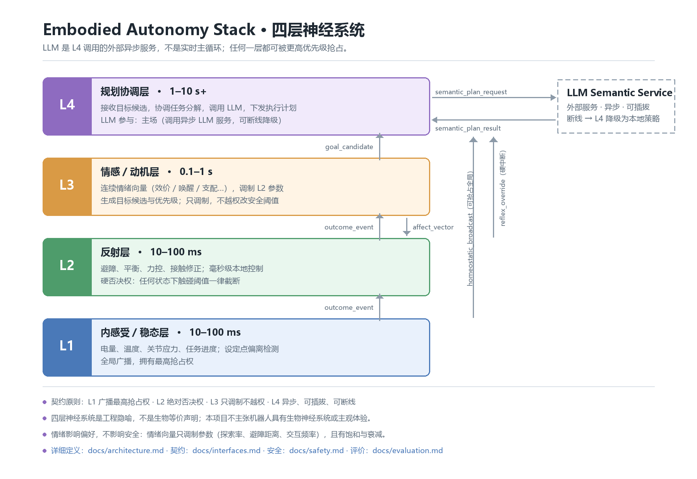

# 架构

> 状态：草案 · 最后更新 2026-11-05 · 长图：[assets/architecture-long.png](assets/architecture-long.png)（源：[.mmd](assets/architecture-long.mmd)）

## 一句话

**L1 说"我饿了" → L3 说"那我现在想去找吃的" → L4 说"路径这样规划，话这么说" → L2 说"路上有坑我躲了"。**

## 分工总表

| 层 | 时间尺度（**目标值，未经实测**） | 职责 | 上级可抢占 | LLM 参与 |
|---|---|---|---|---|
| **L1** 内感受/稳态 | 10–100 ms | 电量、温度、关节应力、任务进度；设定点偏离检测；全局广播 | 无（最高） | 不参与 |
| **L2** 技能/反射（L2A/L2B） | 10–100 ms | L2A 运动基元（主动执行）；L2B 避障/平衡/力控/接触修正（硬否决） | L1 | 不参与 |
| **L3** 情感/动机 | 0.1–1 s | 连续情绪向量；目标候选与优先级；调制 L2 参数 | L1 / L2 | 不参与（可调本地小模型） |
| **L4** 规划协调 | 1–10 s+ | 接收目标候选，协调任务分解，调用 LLM，下发执行 | L1 / L2 | 主场：调用异步 LLM 服务 |
| *外部* LLM | 秒级，不可靠 | 语义规划、对话 | 不适用（可断线） | 它就是它自己 |

### 仲裁顺序（固定，已落码）

冲突时"谁赢"由一张**序数表**决定，与时间尺度无关：优先级只回答"两者同时有效时归谁"，
不回答"多久必须回应"（后者全部 TBD，见下方）。

| 序 | 权威 | 代码键 | 说明 |
|---|---|---|---|
| 1 | 硬件急停 / 安全回路 | `hardware_estop` | 真机独立回路；仿真中只是占位，从未真正达成 |
| 2 | L1 生存保护 | `l1_survival` | 过热、断电、应力超限、失衡 |
| 3 | L2B 硬反射 | `l2b_reflex` | 防碰撞、防跌落、力超限 |
| 4 | L3 用户软指令 | `l3_user` | 含软急停与偏好调制（不改阈值） |
| 5 | L4 规划目标 | `l4_plan` | 只出候选目标，永不直接写关节 |
| 6 | L2A 技能执行 | `l2a_skill` | 别人都不生效时才独占执行器 |

- 唯一事实源：`sim/config.py` 的 `PRIORITY` / `PRIORITY_ORDER`（权重是序数编码，不是物理量）。
- 断言：`cd checks && node check-priority.mjs`。脚本内另硬编码一份权威序，
  避免"拿 config 证明 config"的恒真检查。
- **为什么这张表不写时延**：L1 声称"最高抢占权"却又标 10–100 ms，而 L2B 硬反射要在 1–10 ms 内刹车——
  混写会让实现互相打架。层号是地址，时钟才是速度，两件事分开定。

## L1 · 内感受 / 稳态

**唯一职责**：定义"正常"是什么，并检测偏离。

- 监控变量（v0.1 范围）：电量、关节/驱动器温度、关节应力/电流、任务进度。
  > 变量清单是**提案**，需在仿真里标定后再定稿——见下方 TBD 表。
- 设定点：每个变量有目标区间；偏离程度归一化为 0–1 的 `severity`。
- 输出：`homeostatic_broadcast`（可抢占全局），见 [interfaces.md](interfaces.md)。

**记忆怎么放（2026-11-08 裁定）**：记忆**不是一个层**。L1 只放「寄存器」——高频、定长、写路径不分配内存；
任务进度这类语义状态放「单写者黑板」，L1 只读一个轻量令牌（`skill_id` / `phase` / `seq`）；长期经验留在 L4。
实现：[`sim/memory/store.py`](../sim/memory/store.py)（`Registers` / `Blackboard` / `Ring` / `Token`），
自检 `python -m sim.test_memory`。

- 实测（本机 1 s 压测，n=1）：写 475k–486k 次，p50 **0.30 µs** / p99 **0.60 µs**，gc 0 次；
  环 `dropped` 与 `pushed − capacity` 逐数对上。
- `gc=0` 怎么来的：gen0 触发看的是「存活容器数净增」，快照被下一次发布立即替换、旧对象全靠引用计数释放，
  净增到不了阈值——不是把 gc 关了（测试里断言了 `gc.isenabled()`）。
- 边界：`snapshot()` 会分配元组（慢路径）；传 int 会先造一个临时 float；frozen 令牌挡的是误写，不是安全边界。
- **只实现内感受的 homeostatic 分支**：allostatic（按不确定性在偏离发生前重评估设定点）**未实现**，
  因此本层严格说是"稳态层"而不是完整的"内感受层"。理由与回来做的条件见
  [ADR-0004](adr/0004-l1-homeostatic-only.md)。
- 不做：路径规划、语义理解、对话。

**为什么它必须在最底层**：如果需求由 L4 或 LLM"想起来"，那么 LLM 一断线，需求就消失了——
而需求的中断恰恰最危险（没电不会因为模型掉线而停止没电）。

## L2 · 技能（L2A）/ 反射（L2B）

**唯一职责**：在毫秒级把危险动作掐掉；两条通道并排，共用一个执行器。

| 子层 | 性质 | 做什么 | 不做什么 |
|---|---|---|---|
| **L2A 技能** | 主动 | 运动基元：靠近、对准、闭合（策略 / 轨迹 / 脚本） | 不决定"去哪"（归 L4）；不改安全阈值 |
| **L2B 反射** | 被动 | 避障、平衡、力控、接触修正；**硬否决** | 不生产新意图，只在"钳制"意义上赢 |

- 阈值语义见 [safety.md](safety.md)。当前标定只有单障碍物、单速度档（[calibration](../sim/calibration.md)），泛化未测。
- **共用一个执行器就必须有仲裁器**，否则两条通道会互相打摆：[`sim/l2_reflex/arbiter.py`](../sim/l2_reflex/arbiter.py)。
  协议是 `latched → 确认窗 → hold → ramp → idle`，**不是**"反射一消失就交还持权"。
  依据是实测而非设计洁癖：POLICY→HOLD 交接 5/5 摔倒；只加"刹到 |v|<0.05"仍 5/5 摔；
  加上确认窗与斜坡恢复才 0/5（见 [CHANGELOG](../CHANGELOG.md)）。
- 三个时长常数（`RELEASE_CONFIRM_S` / `HOLD_S` / `RESUME_RAMP_S`）是**起点值、未标定**，
  故意拆成三个：调确认窗不该顺手改到保持窗。最坏恢复 ≈ 三者之和。
- 断言：`python -m sim.test_arbiter`（5 组）。任一常数归零都会变红，已反向验过。
- 输出：`reflex_override`（硬中断）、`outcome_event`（事件）；仲裁器另发状态迁移事件（含 `authority`）。
- 接线状态：`sim.main --arbiter on` 才由仲裁器掌权，**默认 `off` 走原来的离散否决路径**。
  10 s A/B（n=1）见 [sim/README](../sim/README.md)：代价是每次否决到桩晚 ≈1.1 s，电量差来自"少充这 1 s"，
  不是多耗能；且这 1.1 s 由三个未标定常数算出——所以暂不设默认。

## L3 · 情感 / 动机

**唯一职责**：把"状态"翻译成"想干什么"。

- 连续情绪状态向量（效价 / 唤醒 / 支配 / 好奇 / 恐惧），取值范围见
  [`contracts/affect_vector.schema.json`](../contracts/affect_vector.schema.json)。
- 两类输出：
  1. 调制 L2 参数（探索率、避障距离、交互频率、任务优先级）——**只调参数，不改阈值**；
  2. 生成 `goal_candidate`（"我想干什么" + 优先级）。
- 不做：语义推理、长程规划、安全决策。

**为什么用连续向量而不是标签**：标签是离散的、回合制的，而调制必须是连续的——
情绪的作用方式是"让某个动作更容易发生"，不是"宣布进入悲伤模式"。

## L4 · 规划协调

**唯一职责**：把目标候选变成可执行计划，并在需要时向外部求助。

- 接收 `goal_candidate`，排序、分解、下发。
- 需要语义时调用外部 LLM 服务（`semantic_plan_request` → `semantic_plan_result`）。
- **L4 不是 LLM**。L4 是规划协调器；LLM 是被它调用的外部服务。
- 断线策略：请求超时 → 回退到本地策略 → 若本地无策略则上报 `outcome_event`。具体超时值 TBD。
- 不做：实时控制、稳态判断。

## 外部 LLM 服务

- 异步、可插拔、可断线。
- 不持有设定点，不生成需求，不改安全阈值。
- 返回的规划结果**可被 L1/L2 抢占**——它是建议，不是命令。

## 耦合原则

| 原则 | 含义 |
|---|---|
| 向上异步 | 上层向下的信号不阻塞下层 tick |
| 向下抢占 | 下层向上必须是"可以打断"的，不是礼貌通知 |
| 单一所有权 | 每个变量只归一层写，其他层只读 |
| 可断线 | 任何一层的上游断掉，本层必须有降级行为 |

## TBD 表（需要实测才能定）

> 这里刻意空着。填这些数需要仿真数据，不接受"看起来合理"的估计。

| 参数 | 建议起点 | 依据 | 谁来定 |
|---|---|---|---|
| L1 采样率 | TBD | 取决于传感器带宽 | 仿真实现者 |
| `severity` 归一化曲线 | TBD | 线性/分段/指数待对比 | L1 实现者 + 评价 |
| 各变量设定点与死区 | TBD | 平台相关（电池化学、电机热模型） | 平台适配者 |
| L2 阈值（力 / 距离 / 限位） | TBD | 必须来自硬件安全规格，不能拍脑袋 | **安全负责人** |
| L3 情绪向量衰减时间常数 | TBD | 与交互节律相关 | L3 实现者 |
| L4 LLM 请求超时 | TBD | 需实测 LLM 延迟分布 | v0.2 实验 |
| 抢占恢复延迟上限 | TBD | 需实测 | v0.3 评估 |
| 各层实际时延（L1/L2A/L2B/L3/L4） | TBD | **禁止照抄本页目标值**，必须本机实测 | 仿真实现者 |

## 待补

- [ ] L1–L2 实时层拆分图（`assets/architecture-realtime.png`）
- [ ] L3–L4 认知层拆分图（`assets/architecture-cognitive.png`）
- [ ] 各层内部模块图与线程/进程模型
- [ ] 与 ROS 2 / DDS 的执行模型映射（决定用话题还是共享内存）
