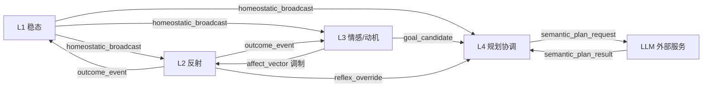

# 层间信号契约

> 状态：草案 · 最后更新 2026-11-05 · 机器可校验定义见 [`contracts/`](../contracts/)

任何一层的输出都可被更高优先级的层抢占。**契约的意义不是"我们说过"，而是"实现了就能对上"。**

## 信号总表

| 信号 | 来源 → 去向 | 类型 | 时间尺度 | 语义 | Schema |
|---|---|---|---|---|---|
| `homeostatic_broadcast` | L1 → 全局 | 优先级广播 | 10–100 ms | 饥饿 / 疲惫 / 过热 / 过载，可抢占 | [homeostatic](../contracts/homeostatic.schema.json) |
| `affect_vector` | L3 → L2/L4 | 连续向量 | 0.1–1 s | 效价 / 唤醒 / 支配 / 好奇 / 恐惧，调制参数 | [affect_vector](../contracts/affect_vector.schema.json) |
| `goal_candidate` | L3 → L4 | 目标候选集 + 优先级 | 0.1–1 s | "我想干什么" | [signals](../contracts/signals.schema.json) |
| `semantic_plan_request` | L4 → LLM 服务 | 异步请求 | 1–10 s | 结构化规划请求 | [signals](../contracts/signals.schema.json) |
| `semantic_plan_result` | LLM 服务 → L4 | 异步响应 | 1–10 s | 规划结果，可被 L1 抢占 | [signals](../contracts/signals.schema.json) |
| `reflex_override` | L2 → L4 | 中断 | <100 ms | "别规划了，要撞了" | [signals](../contracts/signals.schema.json) |
| `outcome_event` | L2/感知 → L3/L1 | 事件 | 10–100 ms | 抓住 / 滑了 / 撞了 / 完成了 | [signals](../contracts/signals.schema.json) |

## 信号流向

> 这张图是**语义源**：GitHub 直接渲染，站点用同一个 Mermaid 组件渲染。
> 注意它只画 7 个信号的方向，不画时序——时序约束在下面的「逐信号要点」里。

## 契约原则

| 原则 | 表述 | 违反的后果 |
|---|---|---|
| L1 最高抢占权 | 广播可打断任何层的当前行为 | 系统在危险状态里继续执行长任务 |
| L2 绝对否决权 | 反射不请求许可，直接截断动作 | 规划正确的动作仍然撞上去 |
| L3 只调制不越权 | 情绪只能改参数，不能改阈值/否决 | 情绪成为安全隐患 |
| L4 异步可断线 | LLM 是建议源，不是命令源 | 网络抖动变成机器人停机 |

## 逐信号要点

### `homeostatic_broadcast`

- 触发：任一变量偏离设定点超过死区。
- 字段：`severity`（0–1）、`cause`、`preemptible`（本项目固定为 `true`，因为它就是最高优先级）。
- 语义约束：接收方**必须在下一个 tick 前检查**；不允许排队等待。
- 常见错误：把它实现成普通事件消息 → 它就变成了"建议"，抢占权失效。

### `affect_vector`

- 触发：L3 每次更新（约 0.1–1 s）。
- 字段：`valence`（−1..1）、`arousal`、`dominance`、`curiosity`、`fear`、`timestamp_ms`。
- 语义约束：接收方只能用它**调参数**；一旦它出现在安全判定里，视为契约违规。
- 提供样例：[`contracts/examples/affect_vector.example.json`](../contracts/examples/affect_vector.example.json)

### `goal_candidate`

- 触发：L3 完成一次目标生成。
- 字段：候选列表，每项含 `goal`、`priority`、`source_need`（由哪条需求驱动）。
- 语义约束：`source_need` 必填——否则无法回答"这个行为是需求驱动的还是指令驱动的"，
  而这条比例是评价体系的核心指标（见 [evaluation.md](evaluation.md)）。

### `semantic_plan_request` / `semantic_plan_result`

- 必须携带 `request_id`，用于超时与取消。
- 结果落地前必须过 L1/L2 检查：**规划结果永远可以被抢占**。
- 断线：请求超时 → L4 走本地降级策略；降级策略本身要能被记录（否则无法算"断线存活"）。

### `reflex_override`

- 延迟上限 < 100 ms；这是硬要求，不是目标。
- 字段：`reason`、`interrupted_task`、`safety_margin`。
- 语义约束：L4 收到后必须立刻挂起当前计划，不允许"做完这一步再停"。

### `outcome_event`

- 事件类型枚举：`grasp` / `slip` / `collision` / `completion` / `failure`（草案，可扩展）。
- 双写：同时发给 L3（更新动机）和 L1（更新进度/应力）。
- 去重：同一物理事件只发一次，由感知层负责。

## 版本

契约当前为 `v0.1-draft`。破坏性改动需 ADR 并升 major；新增可选字段升 minor。
详见 [`contracts/README.md`](../contracts/README.md)。

## 待补

- [ ] `goal_candidate` 的优先级计算公式（当前只有字段，没有算法）
- [ ] 各信号的序列化格式（JSON 为参考实现，DDS/共享内存为性能实现）
- [ ] 时序图：一次"电量骤降"从 L1 到 L4 的完整抢占时序
- [ ] 错误码与重试语义
