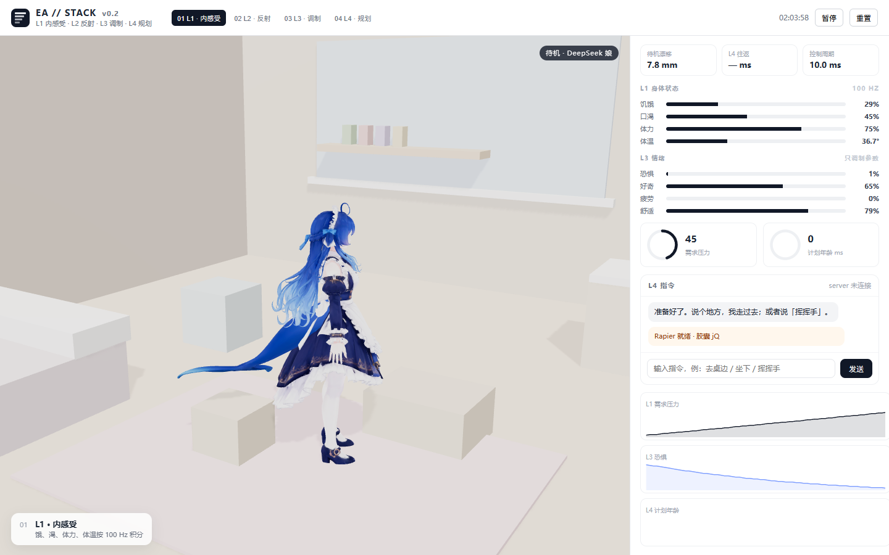

# ETS-Testbed · 可复现的具身时间尺度跑分台

> 状态：草案（v0.2.0 已跑出第一份数据） · 最后更新 2026-11-06

`testbed/` 是 v0.2 起的**第二套栈**：TypeScript + Rapier（刚体碰撞）+ Three.js（渲染）+ uPlot（曲线），
物理控制环在 Web Worker 里跑 100 Hz，LLM 是异步外部服务。

它和 `sim/`（MuJoCo，v0.1）的关系只有一条：**共用同一套分层语义与同一组参数**，数字不共用。
为什么换栈、被否掉什么，见 [ADR-0007](adr/0007-visualization-stack-switch.md)。

## 一条命令能看到什么

```bash
cd testbed
npm install
npm run dev        # 两个页面：/index.html（技术台）· /console.html（演示台）
npm run bench      # headless 批跑：场景 x 基线 x 延迟 x seed
npm test           # 确定性 / 过期策略 / 区间估计
```

## 演示台（`console.html`）



按参考视频（HAST-SEC 那两支）复刻的**演示形态**：左边是房间里的角色与气泡，右边是
指标卡（待机抖动 / 语义延迟 / 控制延迟）、两个环形量表（认知负载 / 任务进度）、
对话控制与会话记录，下面是三条实时曲线，底部是章节字幕。

现状与边界：

| 部分 | 状态 |
|---|---|
| 布局 / 交互 / 指标面板 / 章节字幕 | 已有，可点、可对话、可切章节 |
| 角色 | **DeepSeek 娘**（本地 GLB）：Mixamo 骨架 209 骨、2 个蒙皮网格、材质内嵌；程序化骨骼动作（待机/行走/挥手）。**不随仓库分发**（整包标"不可商用"） |
| 兜底角色 | 银狼（本地 PMX）→ 小鲸鲸 · 幼年（CC BY 4.0）：前者不在就退后者 |
| 动作来源 | **骨骼动画**，不是 Rapier 驱关节：只做 rest × 单轴小角度的"摆"，不给力矩，所以关节不会被拧 |
| 房间 | 程序化几何（墙 / 窗 / 床 / 桌 / 架），不是扫描资产 |
| L1 身体状态 | **真实积分**：饿/渴/体力/体温按 100 Hz 累加，到水杯/冰箱/床会被"解决" |
| L4 规划 | 已接 [`server/`](../server/README.md)（FastAPI）：需求过线才发请求，返回带 `requested_sim_time_ms`，年龄超 1500 ms 作废并重规划 |
| L4 往返 / 计划年龄 | 来自服务实测（服务端补齐 900 ms 延迟），不是合成曲线 |
| L2 反射 | 已接：指针视线追随（头/颈，<100 ms）、用户指令打断在途计划、遇障后退（硬中断，1.2 s 冷却） |
| L3 情绪 | 已接：恐惧/好奇/疲劳/舒适四个标量；**只调制**步速与视线增益，不参与遇障判定 |
| 物理 | **Rapier 胶囊**已接进 console：角色是动态胶囊（锁旋转），家具是静态碰撞体；骨骼只是"跟着胶囊的视觉体" |
| 动作 | 5 个：走 / 坐 / 拿 / 喝水 / 被吓；都是关节角度覆盖，不给力矩 |
| L3 → L4 | 情绪已进请求体（fear/curiosity/fatigue），服务端按"累了先休息、怕了先退、好奇去看看"改选择；**不改安全判定** |
| 与物理栈的接线 | `console.html` 与 `index.html` 仍是两条线；Rapier 只在 console 里 |

模型的分发边界见 `testbed/public/models/README.md`：

- DeepSeek 娘 / 银狼：**本地私有**，`.gitignore` 排除，克隆者看不到；
- 小鲸鲸：CC BY 4.0，随仓库分发并署名。

加载顺序：`models/deepseek.glb` → `models/silverwolf/silverwolf.pmx` → `models/whale-child.glb` → 程序化占位。

为什么用 MMDLoader 而不是先转 glTF：mmd_tools 导出的 GLB 在这套模型上蒙皮是坏的（顶点被甩成碎片，
实测两版都炸）；原生 PMX 由 three 的 MMDLoader 解析，骨骼/材质/形态键都正常。three 0.187 已移除
MMDLoader，所以 `src/vendor/` 里 vendored 了一份（0.160 的版本 + 改了三处 import）。

**命名**：界面统一用本项目的层号（L1 内感受 / L2 反射 / L3 调制 / L4 规划），
不再借用外部 demo 的名字与图标；图标是四道递减的横条，对应四层的时间尺度。

**闭环（已跑通的最小闭环）**：

```
L1 饿/渴/体力 100 Hz 积分
   └─ 压力 > 0.78 → L4 请求（异步，实测 ~914 ms）
        └─ 返回 intent + 基于的仿真时刻
             ├─ age > 1500 ms → 作废 + 重新规划（界面记一条 sys 事件）
             └─ 否则 → 走向目标点，到了就把对应需求降下去

L2 反射（每条都优先于 L4）
   ├─ 指针移动 → 头/颈追随（跟随强度由 L3 的好奇调制）
   ├─ 用户输入 → 作废在途计划（"L2 打断 · 用户指令优先"）
   └─ 下一步会撞到家具 → 强制后退 0.45 s + fear +0.45（阈值不看情绪）

L3 情绪（只改偏好）
   fear → 步速 ↓、视线增益 ↑；curiosity → 闲时视线更紧；
   fatigue → 步速 ↓；comfort = 1 − 0.45·压力 − 0.35·fear − 0.2·疲劳
```

**安全边界**：撞没撞由 Rapier 解算（"想要的速度没兑现"就是撞了），后退时长与冷却时间是常数；
`fear` 只能影响"之后走多快、看多紧"，不能改判定。这是 `docs/safety.md` 那条硬约束在代码里的落点。

**为什么角色不做刚体链**：皮肤网格 2.7 万顶点、209 根骨进物理必然抖且慢；胶囊负责人在哪，
骨骼负责长什么样。代价是"被推倒/被扶起"这类交互做不了——写进"不是什么"。

升级路径：Rapier 胶囊体接入（人走物理、视觉跟胶囊）；
换角色改 `MMDLoader().load(...)` 或 `gltfLoader.load(...)` 的路径即可。

## 设计（三层，各管一件事）

| 层 | 位置 | 频率 | 职责 |
|---|---|---|---|
| 物理 + L1–L4 | `src/core/`（纯逻辑，无 DOM） | 100 Hz 固定步长 | 决策与碰撞，可被 Node 直接跑 |
| Worker | `src/worker/` | 100 Hz | 只做"跑循环 + 批量回传"，不含策略 |
| 渲染 | `src/app/` | 60 fps | Three.js 画场景、uPlot 画曲线；**不参与决策** |

`src/core/` 不依赖浏览器，这是批跑与单测能成立的前提：同一份代码，UI 里实时跑，Node 里虚拟时间跑。

## 时间怎么算

两种驱动方式共用同一个 `Sim.step()`：

- **virtual**（bench）：不睡墙钟，跑多快算多快。同一 seed → 同一 `stateHash`（`npm test` 有一条断言）。
- **realtime**（UI）：Worker 每 10 ms 推一步；主线程只做插值渲染。

报告里的"到达时间"是**仿真秒**，不是墙钟秒。

## 过期指令：v0.2 的核心机制

请求带 `gen` 与 `requested_sim_time`；结果到达时执行器算 `age = now - requested_sim_time`：

| 策略 | 行为 | 用在哪 |
|---|---|---|
| `adopt` | 照旧执行（只保留请求超时） | `b0f`（公平 B0） |
| `discard` | `age > 500 ms` 就丢弃，连续 2 次后降级到本地状态机 | `full` / `b2` |

**这是 v0.2 最重要的实验结果，而且是阴性**：见 [evals/v0.2/README.md](../evals/v0.2/README.md)。

## 不是什么（写清楚，免得被当成承诺）

- **不是 MuJoCo 的替代品**：底盘是"刚体 + 旋转锁定 + 速度驱动"，不做悬挂、轮胎摩擦、电机模型。
  本台账测的是时间尺度，不是底盘动力学保真度。
- **不是人形**：v0.1 的 `sim` 是轮式底盘，`testbed` 也是。G1/VRM 不在 v0.2 里（换人形会改掉任务语义与全部标定）。
- **不是真模型**：默认 `MockLLM` 是规则规划器，不是 VLM/LLM。它只回答"按规则该去哪"，
  不产生语义理解——所有"LLM 延迟"都是**仿真时间**上的可控延迟，不是网络实测。
- **渲染层不跑 L1–L3**：UI 只读 Worker 回传的采样。想让画面"看起来更聪明"只能改 core，改不了渲染。

## 参数从哪来

`src/core/params.ts` 里带 `@mirror` 注释的常量镜像 `sim/config.py`，
`npm run check:params` 会对账（不一致就红）。带 `@own` 的是本栈自己的（时序、统计、`STALE_AGE_MS`）。

当前对账：**25 个 @mirror 常量，0 处不一致**。

## 目录

| 路径 | 职责 |
|---|---|
| `src/core/params.ts` | 参数表（@mirror / @own） |
| `src/core/scenario.ts` | 场景定义 + 移动目标点 |
| `src/core/world.ts` | Rapier 包装：碰撞、12 条射线、接触力 |
| `src/core/l1..l4.ts` | 四层（与 `sim/` 同语义） |
| `src/core/baselines.ts` | 基线开关的唯一事实源 |
| `src/core/sim.ts` | 组装 + `stateHash` + 指标 |
| `src/bench/` | 批跑、统计、SVG |
| `src/app/` · `src/worker/` | 实时 UI |

## 下一步

- `revalidate` 策略（"过期但当前感知仍然安全就采纳"）——这是本版阴性结果直接指向的修复。
- 移动障碍场景（时间变化带来危险，而不只是目标移动）。
- 抢占在 v0.2 场景里没有触发过一次（`b2` 与 `full` 数字完全相同），需要专门构造触发条件。
